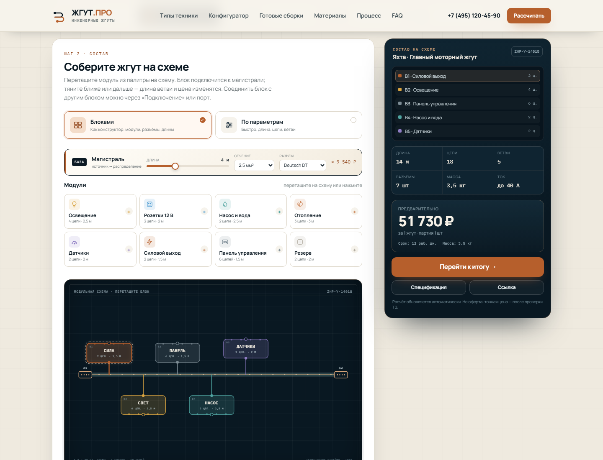

# ЖГУТ.ПРО — сайт с конфигуратором жгутов

Статический прототип сайта производства жгутов для **яхт, автодомов и автомобилей**.
Лендинг + пошаговый конфигуратор: цена, эскиз, состав, спецификация и заявка —
без бэкенда, сборки и зависимостей.

**Демо:** [qvgdsqvgds1324-sys.github.io/zhgut-pro](https://qvgdsqvgds1324-sys.github.io/zhgut-pro/)


## Что умеет

- **3 типа техники × 5 назначений** — 15 готовых сценариев жгутов.
- **6 шагов конфигуратора**: техника и назначение → состав → провода →
  разъёмы и защита → опции → итог.
- **Два режима сборки**:
  - *по параметрам* — длина, цепи, ветви;
  - *блоками* — магистраль + модули (свет, розетки, насос, отопление,
    датчики, силовой выход, панель, резерв).
- **Блочный редактор на схеме**: перетаскивание модулей из палитры прямо
  на холст, перемещение блоков, подключение к магистрали или другому блоку,
  дублирование и удаление, настройка цепей, длины ветви, сечения и разъёма.
  Цена блока видна в панели настроек.
- **Живой расчёт**: цена, срок, масса, количество разъёмов пересчитываются
  на каждое изменение.
- **Автоматический эскиз жгута** в SVG: в блочном режиме — цветные модули
  на магистрали, в параметрическом — ветви и разъёмы. Размер и штамп
  с кодом конфигурации.
- **Серийные скидки** за партию 3/5/10/25/50 шт.
- **Спецификация** — скачивание в `.txt` (UTF-8 с BOM) и печать/PDF (A4).
- **Ссылка на расчёт** — состояние кодируется в `#cfg=...`, можно отправить клиенту.
- **Сохранение** текущей конфигурации в `localStorage`.
- **Заявка** — собирается письмо `mailto:` с полной спецификацией и контактами.
- **Три готовых пресета** на лендинге.
- Адаптив до 320 px, мобильная закреплённая панель с ценой, доступность с клавиатуры.

### Блочный редактор на схеме



Жгут собирается прямо на схеме:

- модуль перетаскивается из палитры на холст и подключается к магистрали;
- блок можно тянуть мышью или пальцем: ближе к магистрали — короче ветвь
  и дешевле, дальше — длиннее и дороже;
- порт на внешней стороне блока и панель «Подключение» соединяют блоки
  между собой (с защитой от циклов);
- выделенный блок открывает настройки под схемой: цепи, количество, сечение,
  разъём, подключение и точная длина;
- блоки дублируются и удаляются, лимиты 12 ветвей / 64 цепи / 30 м
  не дают собрать невалидный жгут;
- цена, срок, масса и эскиз справа пересчитываются сразу.

На телефоне схема прокручивается вбок, а блоки тянутся пальцем.

## Как открыть локально

Двойной клик по `index.html` — сайт работает из файла, сервер не нужен.
Для проверки ссылок и `localStorage` удобнее локальный сервер:

```powershell
npx serve .
# или
node -e "const h=require('http'),f=require('fs'),p=require('path');h.createServer((q,s)=>{let u=q.url==='/'?'/index.html':q.url.split('?')[0];let t=p.join(process.cwd(),u);try{s.end(f.readFileSync(t))}catch(e){s.statusCode=404;s.end('404')}}).listen(4173)"
```

Затем открыть `http://localhost:4173/`.

## Структура

```text
index.html          — разметка лендинга и контейнеры конфигуратора
css/styles.css      — дизайн, адаптив, печатная версия A4
js/data.js          — типы техники, назначения, материалы, разъёмы, опции,
                      скидки, пресеты, контакты
js/calc.js          — расчётная модель (чистая функция state → цена/состав)
js/app.js           — шаги, блочный редактор, эскиз SVG, ссылка, спецификация, заявка
preview.png         — скриншот лендинга для README
preview-blocks.png  — скриншот блочного редактора
.nojekyll           — отключает Jekyll на GitHub Pages
```

## Где менять данные

| Что | Файл |
|---|---|
| Типы техники и 15 назначений | `js/data.js` → `TYPES` |
| Модули Lego-конструктора | `js/data.js` → `BLOCKS` |
| Типовые наборы блоков и магистраль | `js/data.js` → `BLOCK_SETS`, `TRUNK_DEFAULTS` |
| Геометрия холста и шкала «пиксели → метры» | `js/data.js` → `CANVAS` |
| Условия эксплуатации | `js/data.js` → `ENVIRONMENTS` |
| Сечения, изоляция, жила, цвета | `js/data.js` → `SECTIONS`, `INSULATION`, `CONDUCTORS`, `COLORS` |
| Разъёмы и защита | `js/data.js` → `CONNECTORS`, `SLEEVES`, `IP`, `LABELS` |
| Опции и цены | `js/data.js` → `EXTRAS` |
| Скидки за партию | `js/data.js` → `QTY_OPTIONS` |
| Пресеты | `js/data.js` → `PRESETS` |
| Контакты, телефон, e-mail | `js/data.js` → `CONTACTS` и `index.html` |
| Ставки материалов/работы | `js/calc.js` → `RATES`, `BASE_LABOR`, `LABOR_PER_CIRCUIT` |
| Коэффициенты типов | `js/data.js` → `coef` у каждого типа |

После изменения цен проверьте расчёт в браузере: `js/app.js` кэширует только
состояние, суммы считаются на лету.

## Публикация на GitHub Pages

1. Создайте репозиторий и загрузите содержимое этой папки в ветку `main`.
2. **Settings → Pages → Build and deployment**: Source — *Deploy from a branch*,
   Branch — `main`, Folder — `/ (root)`.
3. Через минуту сайт будет доступен по адресу
   `https://<username>.github.io/<repo>/`.

Все пути относительные, поэтому сайт работает и в подпапке GitHub Pages,
и из корня домена.

## Ограничения прототипа

- **Бренд, телефон, e-mail и адрес — плейсхолдеры.** Замените на реальные данные
  перед публикацией.
- **Цены — расчётная модель, а не прайс.** Ставки подобраны как ориентир для
  custom-жгутов; точная стоимость фиксируется после согласования ТЗ. Дисклеймер
  есть на сайте и в печатной форме.
- **Заявка не уходит на сервер.** Форма формирует письмо и открывает почтовый
  клиент. Для приёма заявок подключите backend, CRM или Telegram-бота.
- **Эскиз иллюстративный**, не производственный чертёж. На эскизе так и написано.
- **Блочный редактор — не электрический CAD.** Это модульная смета и схема
  верхнего уровня: блоки задают цепи, длины, сечения и серии разъёмов, но
  pinout, трассировка внутри блока и проверка токовых цепочек не рассчитываются.
  Для производства нужен отдельный проект и согласование.
- Нет аналитики, cookie-баннера, онлайн-оплаты и личного кабинета.
- Шрифты Manrope и IBM Plex Mono подключены с Google Fonts; без интернета
  используются системные, вёрстка не ломается.

## Проверено

- Edge 158 (headless): 1440, 768 и 390 px — без горизонтального скролла,
  без ошибок в консоли.
- Сценарии: прохождение всех 6 шагов, смена сечения и опций, скидка за 10 шт,
  пресет, валидация заявки, `mailto:`, печать, ссылка на расчёт и её повторное
  открытие, мобильная панель.
- Блочный режим: переключение режимов, drag из палитры на холст, перемещение
  блоков, drag-подключение к порту другого блока, изменение цепей, длины,
  сечения и разъёма, дублирование/удаление, пересчёт цены, эскиз с модулями,
  печать модульной спецификации, возврат к параметрам без потери настроек.
- Печатная версия: A4, скрытие интерфейса, таблицы спецификации и итог.
